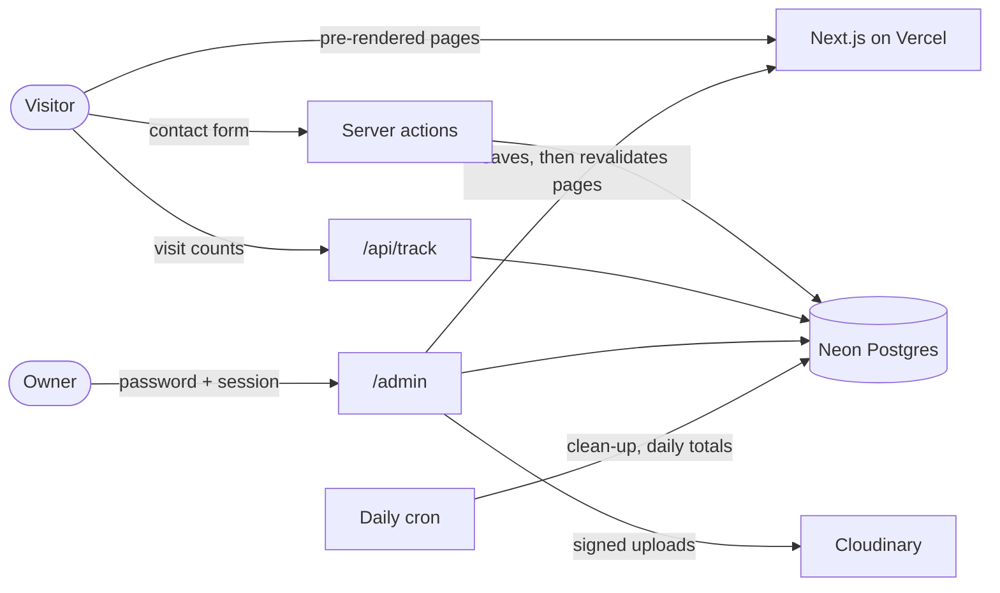

# CTINASSL Activity

**Activity by Kyle Zoleta, Details, blah blah blah.**

## About
**CTINASSL Activity** blah blah blah blah blah blah blah blah blah blah blah blah blah blah blah blah blah blah blah blah blah blah blah blah.

## What's inside

### Feature 1
dfaffewfw

### Feature 2
dfaffewfw

### Feature 3
dfaffewfw

### Feature 4
dfaffewfw

---

## Tech stack

| Layer      | Choice                                                                                                   |
| ---------- | -------------------------------------------------------------------------------------------------------- |
| Framework  | [Next.js 16](https://nextjs.org) (App Router, pre-rendered pages revalidated after admin saves), React 19 |
| Language   | TypeScript                                                                                               |
| UI         | [MUI 9](https://mui.com) (Emotion) with CSS design tokens and cascade layers; [Lucide](https://lucide.dev) and Simple Icons |
| Motion     | [GSAP](https://gsap.com), [Lenis](https://lenis.darkroom.engineering) smooth scrolling, canvas-confetti  |
| Data       | [Neon](https://neon.tech) Postgres with [Drizzle ORM](https://orm.drizzle.team), validated with Zod       |
| Media      | [Cloudinary](https://cloudinary.com) (signed uploads, optimised delivery)                                 |
| Hosting    | [Vercel](https://vercel.com) (region `sin1`) with a daily cron for clean-up and visitor totals            |

